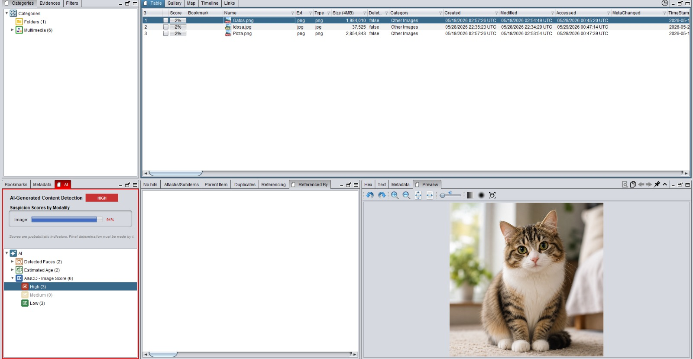

# AIGCD: detecção de imagens geradas por IA no IPED

> **English summary.** AIGCD (*AI-Generated Content Detection*) is a module for
> [IPED](https://github.com/sepinf-inc/IPED) that scores every image of a case with the
> probability of having been generated by AI, using a ConvNeXt V2 model through ONNX Runtime,
> fully offline. The score is stored in the case index and shown in the AI tab of the analysis
> interface, with High/Medium/Low filters for triage. This folder contains the documentation,
> the model export script and the evaluation tools needed to reproduce the work.

O AIGCD é um módulo do IPED que calcula, para cada imagem de um caso, a probabilidade de ela
ter sido gerada por Inteligência Artificial. O cálculo acontece durante o processamento do
caso, totalmente offline, e o resultado aparece na aba **IA** da interface de análise, com um
painel por imagem e filtros **Alto / Médio / Baixo** para triagem.

Desenvolvido como Trabalho de Conclusão de Curso (Sistemas de Informação, Unifesspa) por
Michelangelo de Carvalho Costa, em colaboração com Wemelly Santos Nunes Alvino (Programa de
Pós-Graduação em Ciências Forenses, Unifesspa).



## Como funciona, em uma linha

`iped.exe` processa o caso → o `AIGCDTask` roda o modelo em cada imagem → o score
`aigcd:score:image` (0 a 1) é gravado no índice → o `IPED-SearchApp` mostra o score no painel
e nos filtros.

| Faixa | Score | Significado |
|---|---|---|
| Alto (HIGH) | ≥ 0,70 | Provável imagem gerada por IA |
| Médio (MEDIUM) | 0,40 a 0,70 | Inconclusivo |
| Baixo (LOW) | < 0,40 | Provável imagem real |

O score é um **indicador de triagem**. A decisão final é sempre do perito, e um resultado
Baixo **não** prova que a imagem é real (veja os resultados da avaliação).

## Replicação rápida (Windows)

Passo a passo completo, com explicações e solução de problemas:
[docs/INSTALACAO_E_USO.md](docs/INSTALACAO_E_USO.md).

```powershell
# 1. Pré-requisitos: Git, JDK 11 (Liberica Full JDK) e Maven 3.9+
git clone -b tcc-aigcd https://github.com/Michelangelo-Costa/IPED.git
cd IPED

# 2. Compilar (a primeira vez demora e baixa vários GB de dependências)
mvn clean install -DskipTests

# 3. Baixar o modelo (335 MB) para a pasta de modelos da versão compilada
$REL = "target\release\iped-4.4.0-SNAPSHOT"
New-Item -ItemType Directory -Force "$REL\models\convnext-ai-detector" | Out-Null
curl.exe -L -o "$REL\models\convnext-ai-detector\model.onnx" https://github.com/Michelangelo-Costa/IPED/releases/download/aigcd-modelo-v1.0/model.onnx
(Get-FileHash "$REL\models\convnext-ai-detector\model.onnx" -Algorithm SHA256).Hash
# deve imprimir D9B32082803010AB2EB701F193FD853373A3D49F8429BFF7BB63EC8664F907FB

# 4. Processar uma pasta de imagens e abrir o caso
& "$REL\iped.exe" -d C:\minhas-imagens -o C:\casos\caso-teste
& C:\casos\caso-teste\IPED-SearchApp.exe
```

Nenhum arquivo precisa ser copiado à mão: o módulo e o ONNX Runtime fazem parte da
distribuição compilada e de cada caso processado.

## O que há nesta pasta

| Caminho | Conteúdo |
|---|---|
| [docs/INSTALACAO_E_USO.md](docs/INSTALACAO_E_USO.md) | Instalação do zero, uso da interface e solução de problemas |
| [docs/DOCUMENTACAO_TECNICA.md](docs/DOCUMENTACAO_TECNICA.md) | Arquitetura, integração com o IPED, arquivos alterados, requisitos e limitações |
| [docs/diagramas/](docs/diagramas/) | Diagramas UML (fontes PlantUML e imagens) |
| [modelo/](modelo/) | Origem, licença e script de exportação do modelo ONNX |
| [avaliacao/](avaliacao/) | Ferramentas e resultados das avaliações experimentais |

O código do módulo fica fora desta pasta, junto com o restante do IPED:

| Caminho | Conteúdo |
|---|---|
| `iped-aigcd-plugin/` | Módulo Maven com o `AIGCDTask` (inferência ONNX) |
| `iped-app/src/main/java/iped/app/ui/AIGCDPanel.java` | Painel da aba IA |
| `iped-app/resources/config/` | Habilitação (`IPEDConfig.txt`), registro da tarefa (`TaskInstaller.xml`) e filtros (`AIFiltersConfig.json`) |

## Principais resultados

Avaliação em um caso com 3.219 imagens rotuladas, processado no próprio IPED
([detalhes](avaliacao/README.md)):

| Conjunto | ROC-AUC | IA detectadas (Alto) | Reais marcadas como Alto |
|---|---|---|---|
| GenImage, formato original | 0,990 | 92,9% | 2,6% |
| GenImage, recomprimido em JPEG (qualidade 85) | 0,871 | 43,6% | 2,9% |
| CIFAKE (32×32 px) | 0,585 | 29,0% | 18,0% |

- Desempenho: cerca de 71 ms por imagem (CPU Intel Core i5-12400F), sem nenhuma falha em
  3.219 imagens de formatos e tamanhos variados.
- Limitações: a detecção cai muito após recompressão JPEG, em imagens pequenas e em
  geradores recentes. Como o modelo é um arquivo ONNX substituível, ele pode ser trocado sem
  alterar o código.

## Licenças

| Componente | Licença |
|---|---|
| IPED e o código do AIGCD | GPL versão 3 ou posterior (a mesma do IPED) |
| Modelo ConvNeXt V2 Base (xRayon, Toufik Abbadi) | MIT, ver [modelo/LICENSE](modelo/LICENSE) |
| ONNX Runtime (Microsoft) | MIT |
