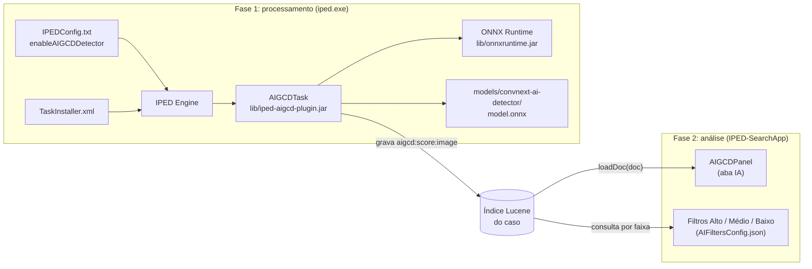

# Documentação técnica do AIGCD

Descrição da arquitetura do módulo, de como ele se integra ao IPED, dos arquivos criados e
alterados e das limitações conhecidas. Para instalar e usar, veja
[INSTALACAO_E_USO.md](INSTALACAO_E_USO.md).

---

## 1. Visão geral

O AIGCD (*AI-Generated Content Detection*) adiciona ao IPED a detecção de imagens geradas por
Inteligência Artificial. Ele funciona em duas fases:

1. **Processamento** (`iped.exe`): a tarefa `AIGCDTask` executa um modelo ConvNeXt V2 em cada
   imagem do caso e grava o score `aigcd:score:image` (0 a 1) no índice Lucene.
2. **Análise** (`IPED-SearchApp`): o painel `AIGCDPanel` exibe o score da imagem selecionada e
   a árvore de filtros da aba IA permite listar as imagens por faixa (Alto, Médio, Baixo).

Toda a inferência é local (offline), o que preserva a cadeia de custódia das evidências.



Fontes PlantUML dos diagramas de arquitetura, classes e casos de uso estão em
[diagramas/](diagramas/).

---

## 2. Modelo de detecção

| Item | Valor |
|---|---|
| Arquitetura | ConvNeXt V2 Base (`convnextv2_base` do timm), 2 classes |
| Autor e origem | Toufik Abbadi (xRayon), [huggingface.co/xRayon/convnext-ai-images-detector](https://huggingface.co/xRayon/convnext-ai-images-detector) |
| Licença | MIT ([../modelo/LICENSE](../modelo/LICENSE)) |
| Checkpoint usado | `checkpoint_phase2.pth` |
| Formato no plugin | ONNX, opset 17, cerca de 335 MB |
| Entrada | `pixel_values` [lote, 3, 256, 256] |
| Saída | `logits` [lote, 2]; índice 0 = real, índice 1 = gerada por IA |
| SHA-256 | `d9b32082803010ab2eb701f193fd853373a3d49f8429bff7bb63ec8664f907fb` |
| Caminho esperado | `<raiz do IPED>/models/convnext-ai-detector/model.onnx` |

O ONNX é gerado pelo script [../modelo/export_onnx.py](../modelo/export_onnx.py) e o resultado
é idêntico, byte a byte, ao arquivo publicado (detalhes em
[../modelo/README.md](../modelo/README.md)).

**Pré-processamento** (implementado em Java no `AIGCDTask`, idêntico ao `test_transforms` do
treinamento):

1. redimensionamento do lado menor para 288 px, interpolação bicúbica;
2. recorte central de 256×256 px;
3. normalização por canal com média (0,485; 0,456; 0,406) e desvio (0,229; 0,224; 0,225) do
   ImageNet.

**Score:** softmax sobre os dois logits; o score é a probabilidade da classe 1:
`score = exp(l1) / (exp(l0) + exp(l1))`.

---

## 3. Integração com o IPED

### 3.1 Pontos de integração

| Ponto do IPED | Como o AIGCD se integra |
|---|---|
| Pipeline de processamento | `AIGCDTask` estende `AbstractTask` e é registrada em `TaskInstaller.xml` |
| Configuração | `EnableTaskProperty("enableAIGCDDetector")` lê a flag do `IPEDConfig.txt` |
| Índice do caso | `item.setExtraAttribute("aigcd:score:image", score)`; o IPED indexa o float como `FloatPoint` (consultas por faixa) e `StoredField` (leitura pelo painel) |
| Árvore de filtros da aba IA | grupo "AIGCD - Image Score" em `AIFiltersConfig.json`, com ícones e rótulos traduzidos |
| Interface | `AIGCDPanel` adicionado à aba IA em `App.java`; `FileProcessor.java` repassa o documento selecionado ao painel |

### 3.2 Empacotamento

O módulo `iped-aigcd-plugin` é um módulo Maven próprio e **dependência do `iped-app`**. Na
compilação, o JAR do módulo e o do ONNX Runtime são copiados para `lib/` e listados no
manifesto do `iped.jar` e do `iped-search-app.jar`, como os demais módulos do IPED. Cada caso
processado leva uma cópia da aplicação, então os casos já contêm esses JARs.

> Histórico: as primeiras versões copiavam o JAR para `lib/` (pasta que o inicializador não
> varre, pois só carrega os JARs listados no manifesto) e o ONNX Runtime para `plugins/`
> (reservada pelo IPED a bibliotecas que não podem ser embutidas por licença). Funcionava
> apenas por causa de uma cópia manual na pasta `plugins/` e exigia copiar arquivos para cada
> caso. A versão atual eliminou esses passos manuais.

### 3.3 Filtros por faixa e idioma

As faixas são declaradas com limites contíguos:

```json
{"name": "High",   "value": "[0.70 TO *]"},
{"name": "Medium", "value": "[0.40 TO 0.70}"},
{"name": "Low",    "value": "[* TO 0.40}"}
```

`}` indica limite superior exclusivo, de modo que todo score pertence a exatamente uma faixa.
Duas alterações em `SimpleNodeFilterSearch` (iped-engine) tornam isso possível:

1. valores terminados em `}` passam a ser reconhecidos como faixa (antes eram tratados como
   frase entre aspas);
2. os limites numéricos, escritos na configuração com ponto decimal, são convertidos para o
   formato do idioma da interface antes da consulta. O `QueryBuilder` do IPED interpreta
   números no formato do idioma; sem a conversão, `0.70` virava 70 em pt-BR, de, es e it
   (todas as imagens caíam em Baixo) e 0 em fr. Os filtros inteiros já existentes no IPED não
   são afetados.

### 3.4 Painel

O `AIGCDPanel` classifica o score com os mesmos limites dos filtros (`HIGH_THRESHOLD = 0.70f`,
`MEDIUM_THRESHOLD = 0.40f`), definidos uma única vez no `enum Level`, junto com as cores de
cada nível. A porcentagem exibida é truncada, nunca arredondada, para não cruzar a fronteira
de uma faixa: um score de 0,6951 aparece como 69%, Médio, e está no filtro Médio.

---

## 4. Arquivos criados e alterados

Em relação ao IPED oficial (`sepinf-inc/IPED`):

### Novos

| Arquivo | Descrição |
|---|---|
| `iped-aigcd-plugin/pom.xml` | Módulo Maven (dependência: ONNX Runtime 1.17.0) |
| `iped-aigcd-plugin/src/main/java/iped/aigcd/AIGCDTask.java` | Tarefa de inferência |
| `iped-app/src/main/java/iped/app/ui/AIGCDPanel.java` | Painel da aba IA |
| `iped-app/src/main/resources/iped/app/ui/filter/AIGCDImage.*.png` | 4 ícones da árvore de filtros |

### Alterados

| Arquivo | Alteração |
|---|---|
| `pom.xml` | Inclui o módulo `iped-aigcd-plugin` |
| `iped-app/pom.xml` | Dependência do `iped-aigcd-plugin` |
| `iped-app/src/main/java/iped/app/ui/App.java` | Adiciona o `AIGCDPanel` à aba IA |
| `iped-app/src/main/java/iped/app/ui/FileProcessor.java` | Chama `aigcdPanel.loadDoc(doc)` ao selecionar um item |
| `iped-engine/src/main/java/iped/engine/search/SimpleNodeFilterSearch.java` | Faixas com limite exclusivo e limites independentes do idioma |
| `iped-app/resources/config/IPEDConfig.txt` | Flag `enableAIGCDDetector` |
| `iped-app/resources/config/conf/TaskInstaller.xml` | Registra `iped.aigcd.AIGCDTask` |
| `iped-app/resources/config/conf/AIFiltersConfig.json` | Grupo de filtros "AIGCD - Image Score" |
| `iped-app/resources/localization/iped-ai-filters*.properties` | Rótulos dos filtros (6 idiomas) |
| `iped-app/resources/localization/iped-desktop-messages*.properties` | Textos do painel (6 idiomas) |

Arquivos exclusivos do fork, fora do código do IPED: a pasta `aigcd/` e os ajustes de
`.gitignore` e `README.md`.

---

## 5. Configuração

| Parâmetro | Onde | Padrão |
|---|---|---|
| `enableAIGCDDetector` | `IPEDConfig.txt` | `true` neste fork |
| Caminho do modelo | fixo no código: `models/convnext-ai-detector/model.onnx` | — |

Se o modelo não existir, a tarefa registra um aviso no log e o processamento continua
normalmente, sem score.

---

## 6. Campos e faixas

| Campo | Modalidade | Situação |
|---|---|---|
| `aigcd:score:image` | Imagem | Implementado |
| `aigcd:score:video`, `:audio`, `:text` | Vídeo, áudio, texto | Previstos para versões futuras |

| Faixa | Regra |
|---|---|
| Alto | score ≥ 0,70 |
| Médio | 0,40 ≤ score < 0,70 |
| Baixo | score < 0,40 |

---

## 7. Padrões de código seguidos

| Padrão do IPED | Aplicação no AIGCD |
|---|---|
| Inicialização única entre threads | `AtomicBoolean` + `synchronized` em `init()` e `finish()`, como no `ImageSimilarityTask` |
| Habilitação de tarefas | `EnableTaskProperty` com a flag `enableAIGCDDetector` |
| Itens fora do caso | `process()` verifica `isToAddToCase()` antes de processar |
| Robustez | falha em uma imagem gera aviso no log e não interrompe o caso |
| Internacionalização | todos os textos via `Messages.getString()`, em 6 idiomas |
| Licença | cabeçalho GPL nos arquivos novos |

---

## 8. Requisitos verificados

Resultados de um caso com 3.219 imagens ([../avaliacao/](../avaliacao/)):

| Requisito | Evidência | Situação |
|---|---|---|
| Score gravado para todas as imagens | 3.219 de 3.219 imagens com score | Atendido |
| Painel e filtros na aba IA | Observados na interface, em inglês e português | Atendido |
| Faixas sem lacuna | Alto 1.096 + Médio 84 + Baixo 2.039 = 3.219 | Atendido |
| Operação offline | Inferência local, sem chamadas de rede | Atendido |
| Desempenho (até 300 ms por imagem) | cerca de 71 ms por imagem | Atendido |
| Robustez | nenhuma falha em JPEG/PNG, RGB/RGBA, de 32×32 a 3456×4608 px | Atendido |
| Reprodutibilidade do modelo | SHA-256 documentado e ONNX regenerável byte a byte | Atendido |

---

## 9. Limitações conhecidas

- **Interface:** o IPED não oferece ponto de extensão para que um plugin adicione painéis à
  interface; por isso `App.java` e `FileProcessor.java` precisam ser alterados.
- **Caminho do modelo** fixo no código; trocar de modelo exige substituir o arquivo.
- **Formatos:** a leitura usa `ImageIO`, que não lê WEBP nem HEIC sem bibliotecas adicionais.
- **Modelo:** forte queda de detecção após recompressão JPEG, desempenho próximo do acaso em
  imagens de 32×32 px e dificuldade com geradores recentes (ver [../avaliacao/](../avaliacao/)).
- **Calibração:** o modelo concentra os scores nos extremos e erra com confiança alta; a faixa
  Médio é pouco usada.

## 10. Trabalhos futuros

1. Arquivo de configuração próprio para o caminho do modelo e os limites das faixas.
2. Gravar o SHA-256 do modelo junto ao score, para auditoria pericial.
3. Avaliar ou ajustar modelos mais robustos a recompressão e a geradores recentes.
4. Detecção em vídeo, áudio e texto.
5. Propor ao IPED um mecanismo de extensão da interface por plugins.
6. Contribuição ao repositório oficial (`sepinf-inc/IPED`) por pull request, contendo apenas o
   código (sem a pasta `aigcd/`) e com `enableAIGCDDetector = false` por padrão, já que o
   modelo não é distribuído com o IPED.
